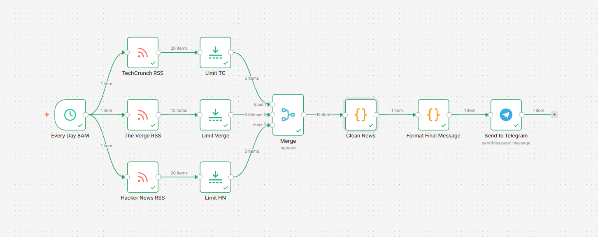
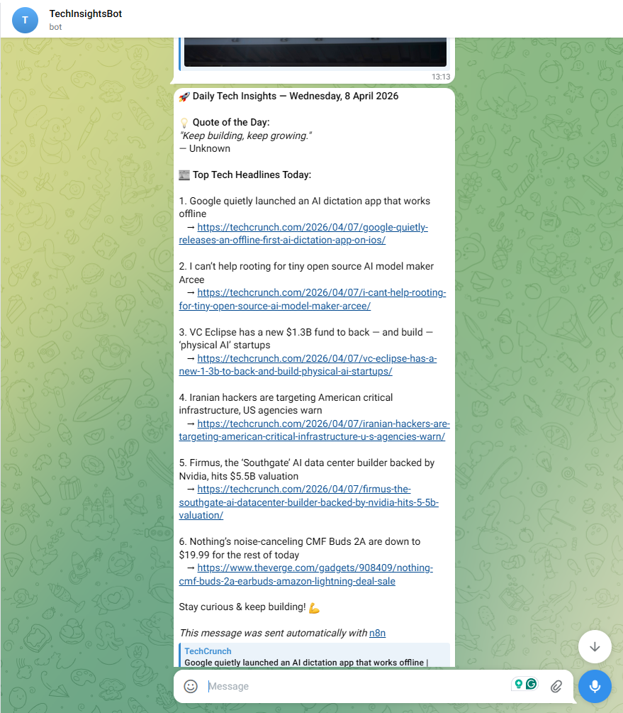

# 🚀 Daily Tech Insights Bot  

---

## 💸 100% Free & No API Keys Required

Completely free to use — no paid services or API keys required.  
Built entirely using public RSS feeds and free integrations.

---

## 📌 Overview

This bot collects the latest technology news from multiple trusted sources, processes and filters it, and sends a clean, readable summary to a Telegram chat — along with a motivational quote.

---

## 🧰 Tech Stack

- ⚙️ n8n (Workflow Automation)  
- 💻 JavaScript (Code Nodes)  
- 🌐 RSS Feeds  
- 🤖 Telegram Bot API  
- 💬 ZenQuotes API  
- 🛠️ Git & GitHub 

---

## 📁 Project Structure

```
Daily-tech-insights-bot/
│── workflow.json
│── README.md
│── screenshots/
│     ├── workflow.png
│     ├── bot.png
```

---

## ⚙️ Features

* 📰 Fetches news from:

  * TechCrunch
  * The Verge
  * Hacker News
* 🔍 Deduplicates headlines
* ✂️ Limits top articles
* 💡 Adds "Quote of the Day"
* 📅 Runs automatically every day at 8 AM
  *(Timezone: Asia/Kolkata)*
* 📲 Sends formatted message to Telegram

---

## 🧠 Workflow Architecture

1. **Trigger**

   * Cron job runs daily at 8 AM (Asia/Kolkata)

2. **Data Collection**

   * RSS feeds from multiple sources

3. **Processing**

   * Limit articles
   * Merge feeds
   * Remove duplicates

4. **Enhancement**

   * Fetch motivational quote (ZenQuotes API)

5. **Output**

   * Send formatted message to Telegram

---

## 📸 Screenshots

### 🔹 Workflow



### 🔹 Telegram Output



---

## 🚀 How to Use

1. Import `workflow.json` into n8n
2. Set up credentials:

   * Telegram Bot API
3. Update:

   * Chat ID
4. Activate workflow

---

## 💡 Use Cases

* Daily tech updates
* Developer productivity
* Learning automation workflows
* Personal AI assistants

---

## 👩‍💻 Author

**Sadiya Bhokare**

---
